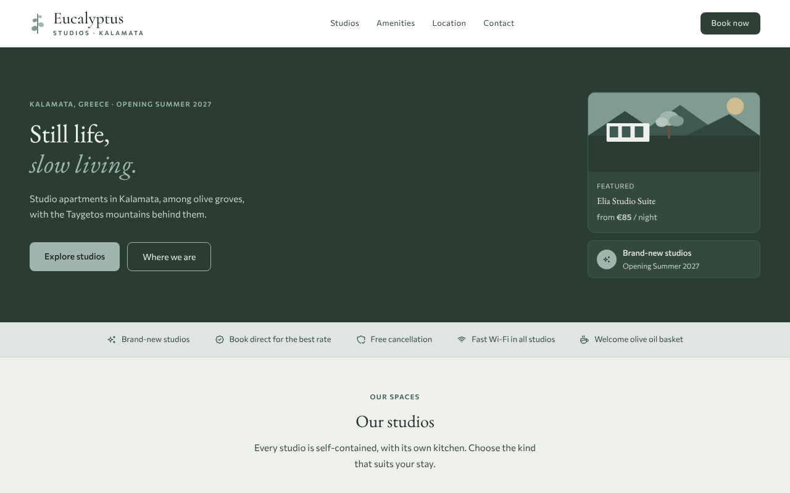
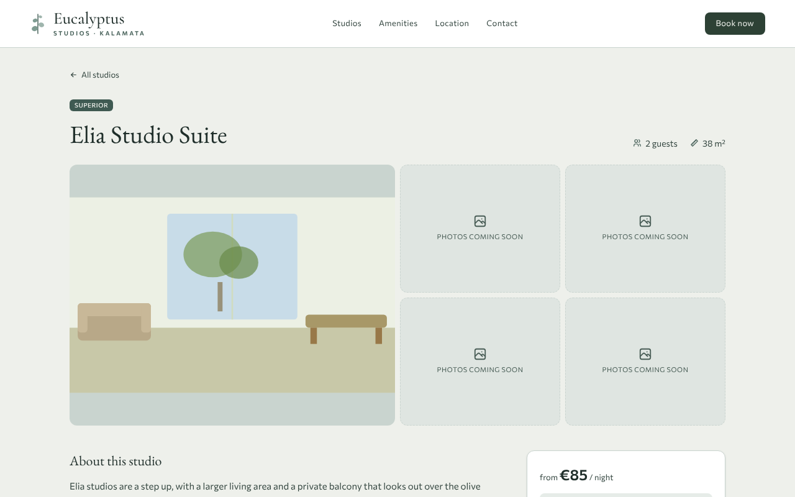
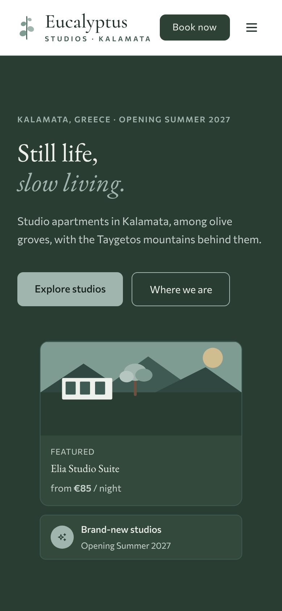

# Eucalyptus Studios

Website for **Eucalyptus Studios**, a boutique collection of studio apartments in Kalamata, Greece, opening in summer 2027.

**Live site:** https://hotel-website-rose-eight.vercel.app



| Studio page | Mobile |
|---|---|
|  |  |

## About the project

A real client project: the marketing and enquiry site for a small hotel that is still being built. The site has to work before there are photos, reviews or a booking system, so it is designed to grow: photo placeholders that real images drop into, forms that stay hidden until they are configured, and opening notices that switch off with one setting.

## Highlights

- **Brand system.** A custom identity around the eucalyptus name: logo (SVG sprig + wordmark), a named colour palette defined once as Tailwind theme tokens, and a type pairing chosen so the whole site already supports Greek.
- **Accessibility.** WCAG AA contrast on every page (verified with axe-core on desktop and mobile), visible keyboard focus, skip link, semantic forms with labels, Escape closes the mobile menu.
- **Privacy by default.** Self-hosted fonts, no trackers, and a Google Map that only loads after the visitor clicks "Show map". Includes a plain-language GDPR privacy page.
- **SEO.** Per-page titles, descriptions and canonical URLs, a sitemap, `LodgingBusiness` structured data and a branded share image for link previews.
- **Performance.** Icons are imported individually instead of as a webfont, which cut each page from about 580 KB to about 90 KB.
- **Enquiries without a backend.** Booking enquiries and "notify me when we open" sign-ups are sent through Web3Forms, with success and error states and a spam honeypot.

## Tech stack

React 19 · Vite · Tailwind CSS 4 · React Router · Tabler Icons · Fontsource · Web3Forms · Vercel

## Structure

```
src/
  pages/        Home, StudioPage (/studios/:id), Privacy, NotFound
  components/   page sections and shared pieces (Logo, EnquiryForm, LinedList, ConsentMap, ...)
  data/         studio and amenity content
  lib/          form sending, per-page meta tags
  siteConfig.js business details and feature switches
  index.css     brand colours and fonts
```

## Running locally

```bash
npm install
npm run dev      # http://localhost:5173
npm run build
npm run lint
```

## Maintaining the site

- **Business details** (form key, email, phone, address, opening date) live in `src/siteConfig.js`. Empty fields are hidden on the site.
- **Studios** are in `src/data/studios.jsx`; each kind of studio gets its own page. To add photos, put them in `public/photos/` and add a `photos` list to the studio.
- **Colours and fonts** are in `src/index.css`. Change a value there and it updates everywhere.
- **Icons:** only the icons listed in `src/components/Icon.jsx` are bundled; add new ones there.
- **Moving to a custom domain:** update `VITE_SITE_URL` in `.env` and the addresses in `public/robots.txt` and `public/sitemap.xml`.

## What's next

Real photography, a Greek language version, a host / story section, a local guide, and a booking engine closer to opening.

---

Design and development by Vasiliki Kleidona. Content and brand © Eucalyptus Studios. All rights reserved.
